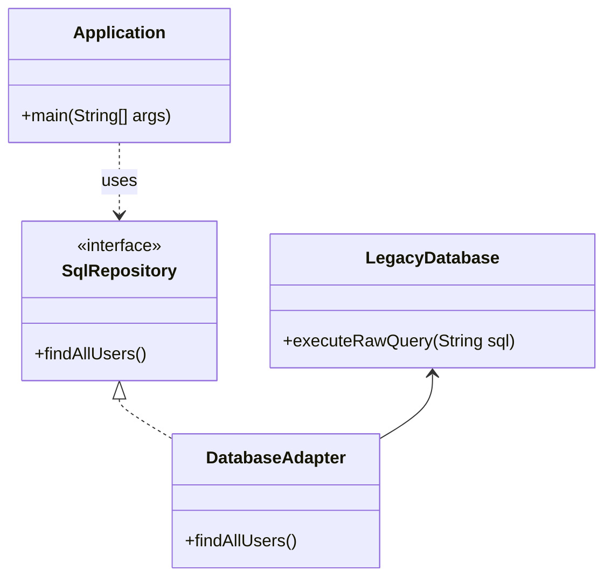

# Adapter Pattern

Below is a simple class diagram for an ORM adapter example.

### Explanation
- `LegacyDatabase` is an existing class with a raw-query API that does not match the repository interface.
- `DatabaseAdapter` adapts the old API into the new interface expected by the application.
- `Application` uses the adapter without knowing the details of the legacy implementation.
