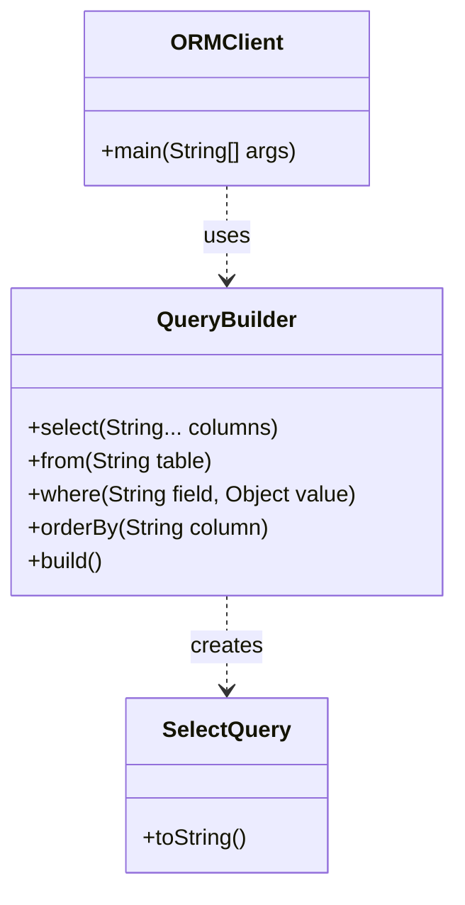

# Builder Pattern

Below is a simple class diagram for an ORM-style SQL query builder example.

### Explanation
- `QueryBuilder` assembles a complex SQL query step by step.
- Each method adds one part of the query without forcing a huge constructor.
- `build()` creates the final query object or SQL string.
- `ORMClient` only cares about the final query, not the construction details.
