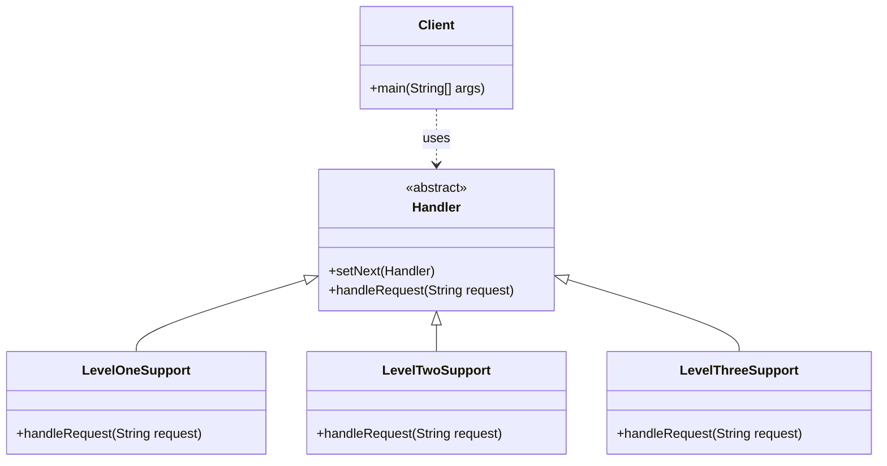

# Chain of Responsibility Pattern

Below is a simple class diagram for a support ticket escalation example.

### Explanation
- `Handler` defines the interface for handling a request and linking to the next handler.
- Each support level checks whether it can handle the issue or passes it along.
- `Client` sends the request into the chain without knowing which handler will solve it.
