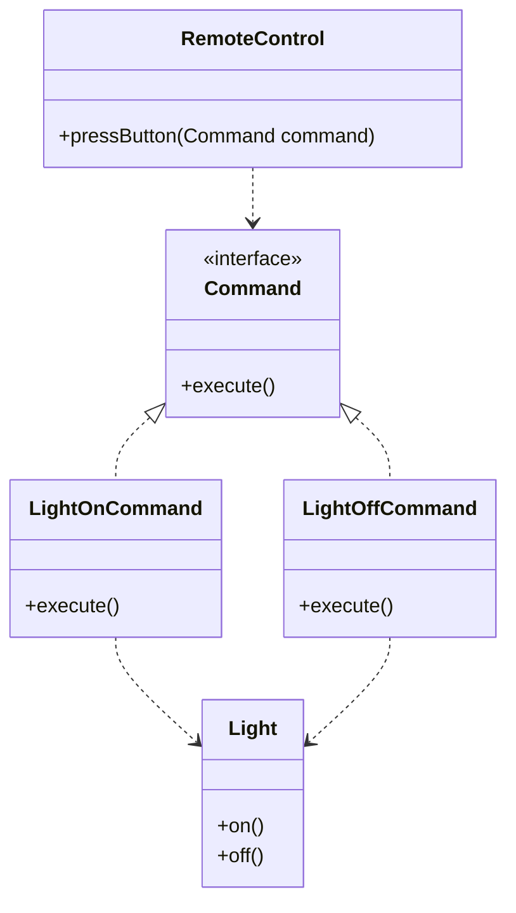

# Command Pattern

Below is a simple class diagram for a remote-control example.

### Explanation
- `Command` defines the common method every action must implement.
- `LightOnCommand` and `LightOffCommand` wrap concrete actions.
- `RemoteControl` invokes commands without knowing the details of the receiver.
- `Light` is the actual object that performs the work.
