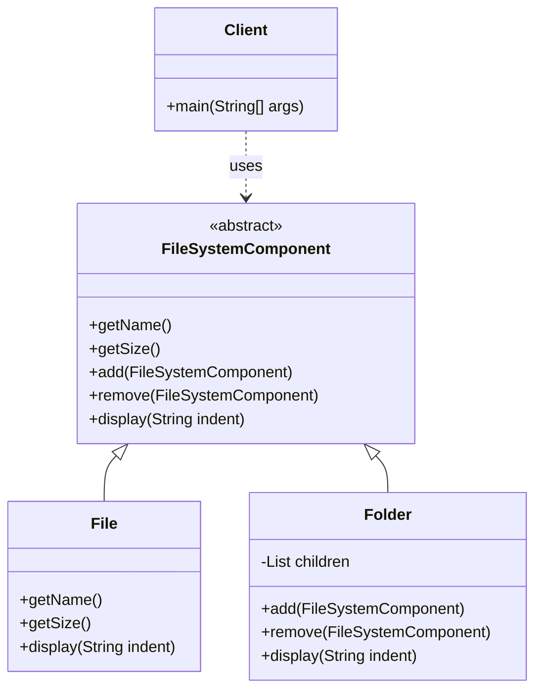

# Composite Pattern

Below is a simple class diagram for a file-system example.

### Explanation
- `FileSystemComponent` is the common abstraction for both files and folders.
- `File` is a leaf node that has no children.
- `Folder` is a composite node that contains other components.
- The client can work with files and folders uniformly using the same interface.
