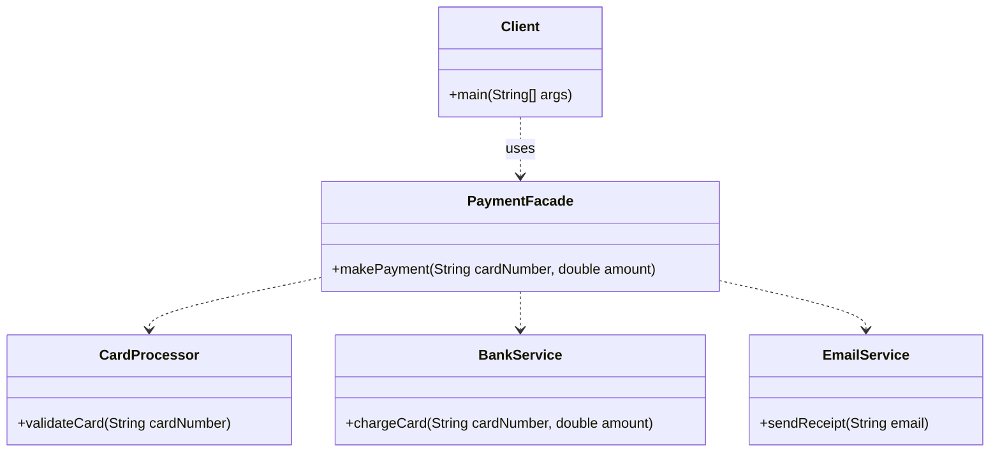

# Facade Pattern

Below is a simple class diagram for a payment processing example.

### Explanation
- `PaymentFacade` hides the complexity of the payment system behind a simple method.
- The client does not need to know about validation, bank charge, or receipt logic.
- The facade provides a single, cleaner interface to a group of subsystems.
