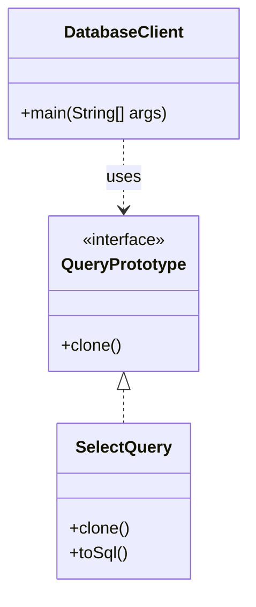

# Prototype Pattern

Below is a simple class diagram for a SQL ORM prototype example.

### Explanation
- `QueryPrototype` defines the cloning contract.
- `SelectQuery` creates new copies of itself without manually reconstructing the object.
- `DatabaseClient` uses the prototype to duplicate query templates quickly.
