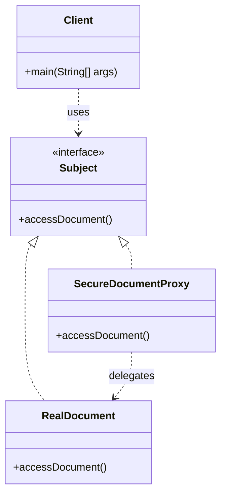

# Proxy Pattern

Below is a simple class diagram for a document access example.

### Explanation
- `Subject` defines the common interface for both the real object and the proxy.
- `RealDocument` performs the actual operation.
- `SecureDocumentProxy` adds access checks before delegating to the real object.
- The client works with the proxy without knowing the internal details.
