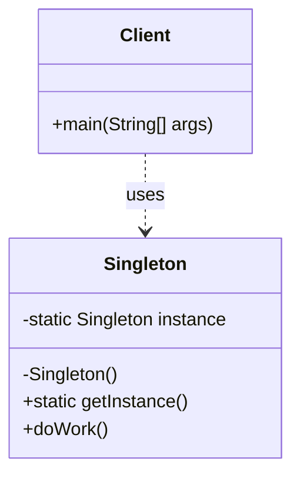

# Singleton Pattern

Below is a simple class diagram for a thread-safe singleton example.

### Explanation
- `Singleton` defines the single global instance and hides its constructor.
- `getInstance()` creates the instance once and reuses it for every call.
- `Client` accesses the singleton through the static method instead of creating new objects directly.
