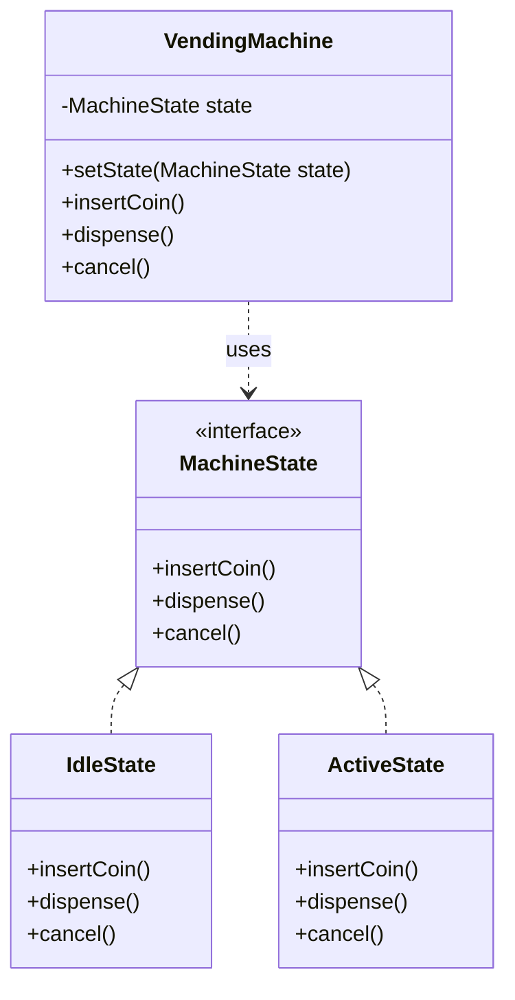

# State Pattern

Below is a simple class diagram for a vending machine state example.

### Explanation
- `MachineState` defines the actions that change depending on the current state.
- `IdleState` and `ActiveState` represent different behaviors for the same machine.
- `VendingMachine` delegates actions to the current state instead of hard-coding all logic in one place.
