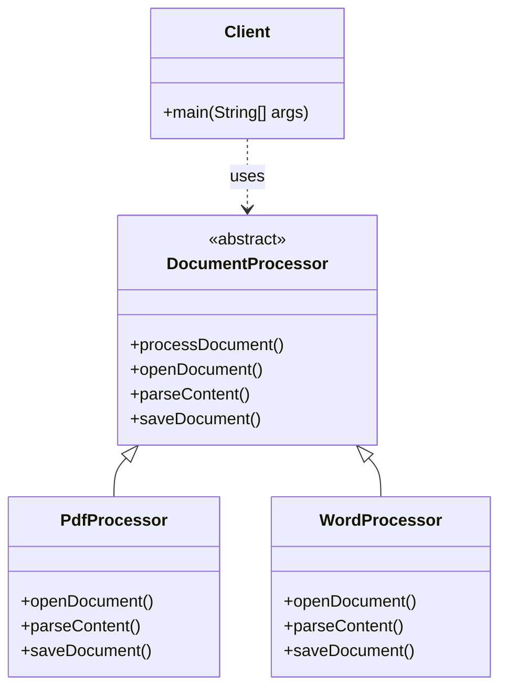

# Template Pattern

Below is a simple class diagram for a document-processing example.

### Explanation
- `DocumentProcessor` defines the overall template: open, parse, save.
- `PdfProcessor` and `WordProcessor` implement the variable steps.
- The algorithm structure stays fixed while the details differ by document type.
